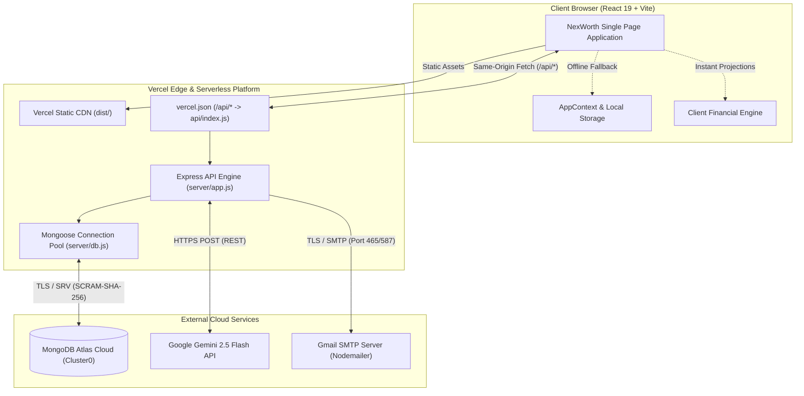

# NexWorth — AI Financial Intelligence Platform

> **Empowering mindful financial choices by connecting daily expense tracking, deterministic opportunity-cost modeling, and conversational AI intelligence.**

[](https://nexworth-ten.vercel.app/)
[](https://github.com/nabeel05-ship-it/NexWorth)
[](https://react.dev/)
[](https://vite.dev/)
[](https://nodejs.org/)
[](https://expressjs.com/)
[](https://www.mongodb.com/atlas)
[](https://ai.google.dev/)
[](https://vitest.dev/)

**Live Application:** [https://nexworth-ten.vercel.app/](https://nexworth-ten.vercel.app/)  
**Source Code:** [https://github.com/nabeel05-ship-it/NexWorth](https://github.com/nabeel05-ship-it/NexWorth)

---

## Table of Contents

1. [Project Overview](#project-overview)
2. [Key Features](#key-features)
3. [Technology Stack](#technology-stack)
4. [System Architecture](#system-architecture)
5. [Project Structure](#project-structure)
6. [Prerequisites](#prerequisites)
7. [Local Installation and Setup](#local-installation-and-setup)
8. [Environment Variables](#environment-variables)
9. [MongoDB Atlas Configuration](#mongodb-atlas-configuration)
10. [API Documentation](#api-documentation)
11. [Financial Calculation Engine](#financial-calculation-engine)
12. [Testing, Linting, and Verification](#testing-linting-and-verification)
13. [Deployment on Vercel](#deployment-on-vercel)
14. [Troubleshooting & Diagnostics](#troubleshooting--diagnostics)
15. [Security & Privacy](#security--privacy)
16. [Known Limitations](#known-limitations)
17. [Roadmap](#roadmap)
18. [Contributing](#contributing)
19. [License](#license)
20. [Acknowledgments & Links](#acknowledgments--links)

---

## Project Overview

Personal financial management often suffers from a fundamental cognitive disconnect: **micro-expenses feel harmless in isolation**, while their cumulative opportunity cost over time remains invisible. A daily discretionary expense of ₹150 (such as takeout coffee or spontaneous delivery orders) represents ₹4,500 monthly, or over ₹54,000 annually. Compounded into a systematic investment plan (SIP) over 5 to 10 years, that same capital could represent several hundred thousand rupees toward major life milestones.

**NexWorth** is a full-stack financial intelligence application created to bridge this cognitive gap. Rather than serving merely as a static ledger, NexWorth acts as an active financial decision partner by:

1. **Illuminating Opportunity Costs:** Instantly converting any recorded expense or planned purchase into its long-term compound growth equivalent ("Buy Now vs. Invest").
2. **Coupling Deterministic Mathematics with Generative AI:** Using rigorously tested financial algorithms for numbers and interest formulas, while leveraging Google's **Gemini 2.5 Flash** model for natural-language analysis, contextual financial coaching, and automated SMS transaction ingestion.
3. **Ensuring High Reliability & Resilience:** Providing seamless cloud persistence via **MongoDB Atlas**, backed by graceful client and in-memory fallbacks when offline or in restricted environments.

---

## Key Features

### 1. Expense & Cash Management
- **Transaction Logging:** Record expenses with amount, merchant, category, payment method (UPI, Credit Card, Debit Card, Cash, Net Banking), transaction date, and custom notes.
- **Categorization & Filtering:** Dynamic category breakdowns across Food, Shopping, Travel, Entertainment, Bills, Health, and Education with real-time total calculations.
- **Visual Analytics:** Interactive spending distributions, historical trends, and month-over-month comparisons rendered via Chart.js and React-Chartjs-2.

### 2. AI Transaction Capture
- **Raw Message Ingestion:** Paste SMS transaction notifications or bank alerts directly into the UI.
- **Intelligent Pattern Matching:** Client-side rule and regex engines extract the merchant, amount, debit/credit status, reference numbers, and transaction dates automatically.

### 3. Financial Intelligence & Insights
- **Monthly Budget Tracking:** Set spending thresholds per category and overall monthly income limits.
- **Deficit Detection:** Automatic detection of over-budget spending conditions compared against recorded income.
- **Spending Forecast:** Trend-based predictive projection for anticipated end-of-month and future-month expenditure.

### 4. Mathematical Opportunity-Cost Calculators
- **Future Value Calculator:** Evaluates lump-sum compound investments ($FV = P \times (1 + r)^n$) with selectable annual or monthly compounding frequencies and complete timeline tables.
- **Spend vs. Save vs. Invest:** Direct comparison between spending an amount, keeping it in a cash/savings account, or allocating it into market investments.
- **What-If Simulator:** Interactive sliders simulate the financial impact of trimming discretionary monthly spending (e.g., cutting ₹500/month from dining out) across 6-month, 12-month, and multi-year horizons.

### 5. Goals Planner
- **Target Tracking:** Track specific financial goals (e.g., Laptop, Emergency Fund, Vacation) with target amounts, current progress, and milestone percentages.
- **Scenario Linking:** Apply simulated What-If savings directly to active goals to visualize acceleration of target completion dates.

### 6. "Ask Your Money" Conversational Assistant
- **Gemini 2.5 Flash Integration:** Multi-turn conversational interface powered by Google Gemini API.
- **Deterministic Grounding:** Backend feeds verified user financial metrics and deterministic calculation engine outputs into Gemini prompts, preventing hallucinated calculations.
- **Multilingual Support:** Conversational interactions and full UI localization available in **English**, **Hindi (हिंदी)**, and **Kannada (ಕನ್ನಡ)**.

### 7. Automated Email Alerts
- **Over-Budget Notification:** Powered by Nodemailer and Gmail SMTP; automatically triggers an HTML email alert when total expenses exceed monthly income.
- **Anti-Spam Debouncing:** Built-in 15-minute debouncing prevents notification flooding during rapid transaction logging.

### 8. Hybrid Cloud & Offline Resilience
- **Real-Time Status Indicator:** The application sidebar unambiguously reports connection health:
  - `Cloud Active: Cluster0` (Connected to MongoDB Atlas)
  - `Cloud Standby (In-Memory Fallback)` (Backend reachable; cluster offline or re-connecting)
  - `Local Sandbox Mode (Offline)` (Operating offline with client state preservation)

---

## Technology Stack

| Layer | Technology | Version | Purpose in NexWorth |
| :--- | :--- | :--- | :--- |
| **Frontend Framework** | React | `^19.2.8` | Component-driven UI architecture and state management |
| **Build Tool & Bundler** | Vite | `^8.3.0` | Ultra-fast development server and production bundle optimization |
| **Data Visualization** | Chart.js & React-Chartjs-2 | `^4.5.1` / `^5.3.1` | Doughnut, bar, and trend line charts for financial distributions |
| **Iconography** | Lucide React | `^1.49.0` | Clean, modern iconography across all navigation and cards |
| **Micro-Animations** | Framer Motion | `^13.4.6` | Smooth page transitions and modal animations |
| **Data Utilities** | PapaParse | `^5.7.0` | Client-side CSV transaction import and parsing |
| **Styling** | Vanilla CSS Tokens | Custom | Tailored design system with sleek dark mode and responsive layout |
| **Backend Framework** | Node.js / Express | `^5.2.1` | REST API routes, middleware, and business logic |
| **Serverless Bridge** | Vercel Serverless | Vercel Node Runtime | Serverless execution of the Express application on Vercel |
| **Database** | MongoDB Atlas | M0 Cluster | Cloud document persistence for transactions, budgets, and goals |
| **ODM / Client** | Mongoose | `^9.10.3` | Schema definition, validation, and connection pool management |
| **AI / LLM** | Google Gemini API | `gemini-2.5-flash` | Conversational reasoning and natural-language financial queries |
| **Email Service** | Nodemailer | `^10.0.13` | Gmail SMTP transport for automated financial alerts |
| **Testing** | Vitest | `^5.0.3` | Fast unit and integration testing engine |
| **Linting** | Oxlint | `^1.81.0` | High-performance JavaScript/React linting |
| **Hosting** | Vercel | Production | Edge hosting, automated previews, and continuous deployment |

---

## System Architecture



### Request Flow
1. **Frontend Request:** The browser sends requests to relative same-origin paths (e.g., `/api/status`, `/api/expenses`).
2. **Serverless Routing:** `vercel.json` rewrites `/api/(.*)` to the serverless entrypoint `api/index.js`, which imports and executes the configured Express application (`server/app.js`).
3. **Database Handshake:** The serverless handler awaits `connectDB()` from `server/db.js`. Mongoose reuses cached connections across serverless warm invocations.
4. **Resilient Fallback:** If MongoDB Atlas is unreachable, the backend serves from an in-memory store and flags the response with `storage: 'memory'`, ensuring uninterrupted user workflows.
5. **AI Queries:** Requests to `/api/ai/chat` calculate deterministic financial figures server-side and inject them into structured prompts sent to the Google Gemini 2.5 Flash endpoint.

---

## Project Structure

```
NexWorth/
├── api/
│   └── index.js                    # Vercel serverless function entrypoint (delegates to server/app.js)
├── public/
│   ├── favicon.svg                 # Application favicon
│   └── icons.svg                   # Vector icon definitions
├── server/
│   ├── models/
│   │   ├── Budget.js               # Mongoose schema for monthly budgets
│   │   ├── Expense.js              # Mongoose schema for financial transactions
│   │   └── Goal.js                 # Mongoose schema for savings goals
│   ├── app.js                      # Main Express application, routes, and business logic
│   ├── app.test.js                 # Vitest backend integration and architecture tests
│   ├── db.js                       # Mongoose connection manager with serverless pooling
│   └── server.js                   # Standalone HTTP server for local backend development
├── src/
│   ├── assets/
│   │   ├── hero.png                # Hero illustration
│   │   └── vite.svg                # Vite logo asset
│   ├── components/
│   │   ├── AIChat.jsx              # "Ask Your Money" conversational interface
│   │   ├── AIInsights.jsx          # Spending analysis, trends, and budget alerts
│   │   ├── AITransactionCapture.jsx# SMS/Notification transaction parser
│   │   ├── Dashboard.jsx           # Main financial metrics, charts, and quick actions
│   │   ├── ExpenseForm.jsx         # Transaction entry and edit modal
│   │   ├── FutureValueCalc.jsx     # Lump-sum future value compound interest calculator
│   │   ├── GoalPlanner.jsx         # Financial goals management and progress tracking
│   │   ├── LanguageSwitcher.jsx    # UI language selector (English, Hindi, Kannada)
│   │   ├── Privacy.jsx             # Security and client data privacy overview
│   │   ├── Sidebar.jsx             # Navigation sidebar and MongoDB connection indicator
│   │   ├── SpendingForecast.jsx    # Forward spending projection engine
│   │   ├── SpendSaveInvest.jsx     # Opportunity-cost comparison tool
│   │   └── WhatIfSimulator.jsx     # Discretionary spending reduction simulator
│   ├── context/
│   │   └── AppContext.jsx          # Global React context, reducer, and sync manager
│   ├── utils/
│   │   ├── aiEngine.js             # Client deterministic AI simulation heuristics
│   │   ├── aiTransactionParser.js  # SMS and bank alert pattern extraction regex engine
│   │   ├── api.js                  # Frontend API client with safe JSON/error handling
│   │   ├── demoData.js             # Initial bootstrap dataset and default categories
│   │   ├── financialCalculations.js# Verified financial mathematical formulas
│   │   ├── financialCalculations.test.js # Vitest benchmark tests for calculations
│   │   └── translations.js         # Comprehensive English/Hindi/Kannada dictionaries
│   ├── App.jsx                     # Root application container and view switcher
│   ├── index.css                   # Core CSS design tokens, typography, and styling
│   └── main.jsx                    # Application entrypoint
├── .env.example                    # Sample environment variables template
├── .gitignore                      # Git ignore rules for node_modules, build, and secrets
├── .oxlintrc.json                  # Oxlint configuration
├── index.html                      # HTML5 template with modern meta tags
├── package.json                    # Project dependencies and script declarations
├── vercel.json                     # Vercel serverless routing and rewrite rules
└── vite.config.js                  # Vite bundler and Vitest test runner configuration
```

---

## Prerequisites

Before setting up NexWorth locally, ensure you have:

- **Node.js:** Version `18.0.0` or higher (verified on Node 20 LTS and Node 24).
- **npm:** Version `9.0.0` or higher.
- **MongoDB Atlas Cluster:** A free M0 or higher cluster on [MongoDB Cloud](https://cloud.mongodb.com/).
- **Google Gemini API Key:** A free API key from [Google AI Studio](https://aistudio.google.com/).
- **Gmail Account (Optional):** Required only if testing automated over-budget email delivery (requires an [App Password](https://myaccount.google.com/apppasswords)).

---

## Local Installation and Setup

### 1. Clone the Repository
```bash
git clone https://github.com/nabeel05-ship-it/NexWorth.git
cd NexWorth
```

### 2. Install Dependencies
```bash
npm install
```

### 3. Configure Local Environment Variables
Create a `.env` file in the project root by copying the provided template:
```bash
cp .env.example .env
```
Open `.env` in your editor and provide your credentials (see [Environment Variables](#environment-variables)).

### 4. Running the Application Locally

NexWorth consists of a Vite frontend and an Express backend. For local development, run them in separate terminal windows:

#### Terminal 1 — Start the Backend API:
```bash
npm run server
```
*The local Express server starts at `http://localhost:5001`, connecting to MongoDB Atlas and listening for API requests.*

#### Terminal 2 — Start the Frontend Development Server:
```bash
npm run dev
```
*The Vite development server starts at `http://localhost:5173` with Hot Module Replacement (HMR).*

Open [http://localhost:5173](http://localhost:5173) in your browser.

> **Tip:** In local development, ensure `VITE_API_URL=http://localhost:5001/api` is defined in `.env` so the frontend directs requests to the local Express server. In production on Vercel, this variable is omitted so the client defaults to relative `/api`.

---

## Environment Variables

All sensitive credentials and endpoints are configured via environment variables.

| Variable Name | Required? | Scope | Description & Source |
| :--- | :---: | :---: | :--- |
| `MONGODB_URI` | **Yes** | Backend | MongoDB Atlas connection string (`mongodb+srv://...`). |
| `PORT` | Optional | Backend | Local backend server port (defaults to `5001`). |
| `VITE_API_URL` | Optional | Frontend | API base URL. **Only used locally** (`http://localhost:5001/api`). **Do NOT set on Vercel**. |
| `GEMINI_API_KEY` | Optional | Backend | Google AI Studio API key used for live Gemini 2.5 Flash chat responses. |
| `EMAIL_USER` | Optional | Backend | Gmail address used as the sender for over-budget alerts. |
| `EMAIL_PASS` | Optional | Backend | 16-character Google App Password (not your Gmail account password). |
| `ALERT_RECIPIENT_EMAIL` | Optional | Backend | Recipient email address for financial alerts (defaults to `EMAIL_USER`). |
| `CLIENT_URL` | Optional | Backend | Canonical URL of the client application used in alert email links. |

### Example `.env` File
```env
# Database
MONGODB_URI=mongodb+srv://<username>:<password>@cluster0.xxxxxxx.mongodb.net/nexworth?retryWrites=true&w=majority&appName=Cluster0
PORT=5001
VITE_API_URL=http://localhost:5001/api

# Google Gemini API
GEMINI_API_KEY=AIzaSyYourGeminiApiKeyHere

# Gmail SMTP Email Notifications (Optional)
EMAIL_USER=your_email@gmail.com
EMAIL_PASS=abcd efgh ijkl mnop
ALERT_RECIPIENT_EMAIL=your_email@gmail.com
CLIENT_URL=http://localhost:5173
```

> **Security Warning:** Never commit `.env` or `.env.local` to version control. The repository's `.gitignore` explicitly excludes all environment files.

---

## MongoDB Atlas Configuration

NexWorth uses **MongoDB Atlas** for document persistence across three primary collections: `expenses`, `budgets`, and `goals`.

### 1. Setting Up Your Cluster
1. Create a free account at [MongoDB Atlas](https://cloud.mongodb.com/).
2. Create an **M0 (Shared)** free tier cluster (e.g., named `Cluster0`).
3. Under **Database Access**, create a database user (e.g., `nexworth_user`) with the **Read and write to any database** privilege and generate a secure password.

### 2. Network Access Configuration
- In Atlas, navigate to **Network Access** > **IP Access List**.
- **For Local Development:** Add your current public IP address.
- **For Vercel Serverless Hosting:** Vercel serverless functions execute on dynamic AWS Lambda IP pools that rotate across the hosting region. On the free M0 tier (which does not support VPC Peering or AWS PrivateLink), you must allow access from anywhere by adding `0.0.0.0/0` with comment `Vercel Serverless Functions`. Connection security is maintained via mandatory TLS (`mongodb+srv`) and SCRAM-SHA-256 user authentication.

### 3. Obtaining the Connection String
1. Click **Connect** on your cluster overview page.
2. Select **Drivers** (Node.js).
3. Copy the connection string and replace `<password>` with your database user password:
   ```
   mongodb+srv://<username>:<password>@cluster0.xxxxxxx.mongodb.net/nexworth?retryWrites=true&w=majority&appName=Cluster0
   ```
4. Paste this into `MONGODB_URI` in `.env` and in your Vercel project settings.

### 4. Verifying Connection
You can verify database connectivity by requesting the `/api/status` endpoint:
```bash
curl -s http://localhost:5001/api/status
```
Expected output when connected:
```json
{
  "connected": true,
  "status": "connected",
  "cluster": "Cluster0",
  "mode": "cloud",
  "env": {
    "hasMongo": true,
    "hasGemini": true,
    "hasEmail": true
  }
}
```

---

## API Documentation

All API endpoints are mounted at `/api` (and handled transparently by the serverless rewrite).

### Health & Diagnostics

#### `GET /api/status`
Returns the operational health, database connection state, and presence of configured integrations without exposing secret values.
- **Response `200 OK`:**
  ```json
  {
    "connected": true,
    "status": "connected",
    "cluster": "Cluster0",
    "mode": "cloud",
    "env": {
      "hasMongo": true,
      "hasGemini": true,
      "hasEmail": true
    }
  }
  ```

---

### Expenses Management

#### `GET /api/expenses`
Retrieves all recorded expenses, sorted by date descending.
- **Response `200 OK`:**
  ```json
  [
    {
      "id": "6aca963be22e3f085d701ed7",
      "_id": "6aca963be22e3f085d701ed7",
      "merchant": "Swiggy",
      "name": "Swiggy",
      "amount": 450,
      "category": "Food",
      "date": "2026-10-10",
      "paymentMethod": "UPI",
      "storage": "cloud"
    }
  ]
  ```

#### `POST /api/expenses`
Creates a new expense.
- **Request Body:**
  ```json
  {
    "merchant": "Coffee Shop",
    "amount": 150,
    "category": "Food",
    "paymentMethod": "UPI",
    "note": "Afternoon break"
  }
  ```
- **Response `201 Created`:** Returns the created record with its cloud `_id` and `storage: "cloud"`.

#### `PUT /api/expenses/:id`
Updates an existing expense by its identifier.
- **Response `200 OK`:** Returns the updated expense object.

#### `DELETE /api/expenses/:id`
Deletes an expense from the database and in-memory store.
- **Response `200 OK`:**
  ```json
  {
    "message": "Deleted successfully",
    "id": "6aca963be22e3f085d701ed7",
    "deletedFromDb": true
  }
  ```

#### `POST /api/expenses/sync`
Accepts an array of expenses to bootstrap or sync records to MongoDB if the collection is empty.

---

### Budgets & Goals

#### `GET /api/budgets` & `POST /api/budgets`
- Retrieve or upsert category spending budget limits.

#### `GET /api/goals`, `POST /api/goals`, & `DELETE /api/goals/:id`
- Retrieve, create, or delete financial savings goals.

---

### AI Financial Assistant

#### `POST /api/ai/chat`
Sends a natural-language query to the AI Financial Assistant. Evaluates deterministic calculations server-side and enriches the response with Gemini 2.5 Flash analysis.
- **Request Body:**
  ```json
  {
    "query": "What if I save ₹1000 per month for Laptop?",
    "income": 30000,
    "goals": [
      { "id": 1, "name": "Laptop", "targetAmount": 60000, "currentAmount": 35000 }
    ],
    "language": "en"
  }
  ```
- **Response `200 OK`:**
  ```json
  {
    "text": "Reducing your Food spending by ₹1,000 per month creates ₹12,000 in savings over 12 months...",
    "scenario": {
      "changeDesc": "Reduce Food spending by ₹1,000/month",
      "monthly": 1000,
      "months": 12,
      "annualSavings": 12000,
      "investedValue": 12809,
      "goalImpact": true,
      "targetGoalName": "Laptop",
      "projectedGoalAmount": 47000
    },
    "model": "gemini-2.5-flash",
    "followUps": [
      "Is ₹1000 ko Laptop Goal mein add karo 💻",
      "What if I invest that amount? 📈"
    ]
  }
  ```

---

### Email Services

#### `GET /api/email/status`
Returns whether email alerts are configured, displaying masked addresses for security.
- **Response `200 OK`:**
  ```json
  {
    "configured": true,
    "emailUser": "na***************@gmail.com",
    "defaultRecipient": "na***************@gmail.com"
  }
  ```

#### `POST /api/email/send-test`
Dispatches a test verification email via configured Gmail SMTP.

#### `POST /api/email/check-overbudget-alert`
Evaluates whether current spending exceeds monthly income. Dispatches an alert email if a deficit is detected and debouncing criteria are met. Supports `dryRun: true` for testing.

---

## Financial Calculation Engine

NexWorth isolates all financial mathematics into a dedicated, unit-tested calculation utility located at [`src/utils/financialCalculations.js`](file:///Users/nsa/Documents/Projects/NexWorth/src/utils/financialCalculations.js).

### 1. Lump-Sum Future Value (Compound Interest)
Calculates the growth of a one-time principal $P$ invested at an annual interest rate $r$ over $n$ years.

- **Annual Compounding:**
  $$FV = P \times (1 + r)^n$$
- **Monthly Compounding:**
  $$FV = P \times \left(1 + \frac{r}{12}\right)^{12 \times n}$$

*Verified Benchmarks (Annual Compounding at 10% p.a.):*
- ₹5,000 for 5 years: **₹8,053**
- ₹5,000 for 10 years: **₹12,969**

### 2. Systematic Investment Plan (SIP / Annuity Due)
Calculates the accumulated value of recurring monthly contributions $M$ deposited at the beginning of each period (annuity due) at periodic monthly rate $i = \frac{r}{12}$ for $N$ total months:

$$FV = M \times \left[ \frac{(1 + i)^N - 1}{i} \right] \times (1 + i)$$

*Verified Benchmark:*
- ₹1,000/month at 12% p.a. for 12 months: **₹12,809**

### 3. Opportunity-Cost Modeling ("Buy Now vs. Invest")
NexWorth strictly avoids comparing a one-time lump-sum purchase against a recurring monthly contribution. Instead, it enforces mathematically honest comparisons:
- **One-time Purchase Evaluation:** Compares spending a lump-sum amount $P$ today versus investing that exact lump-sum amount $P$ for $n$ years at return rate $r$.
- **Recurring Discretionary Spend Evaluation:** Compares spending $M$ every month versus investing $M$ every month into a SIP over $N$ months.

> **Important Financial Disclaimer:** Projections generated by NexWorth are mathematical estimates based on constant return assumptions for educational purposes. Real market returns fluctuate, and past performance does not guarantee future results. NexWorth does not provide certified financial advice.

---

## Testing, Linting, and Verification

NexWorth maintains an automated testing suite using **Vitest** and **Oxlint**.

### Execute Test Suite
```bash
npm test
```
Runs all 27 unit and integration tests across:
- `src/utils/financialCalculations.test.js` (16 financial benchmark tests)
- `server/app.test.js` (11 backend, API routing, serverless bridge, and persistence tests)

### Execute Linter
```bash
npm run lint
```
Runs **Oxlint** across all JavaScript and JSX source files to enforce clean code and catch syntax/import issues with zero errors.

### Execute Production Build
```bash
npm run build
```
Builds the optimized production client bundle using Vite into the `dist/` directory.

---

## Deployment on Vercel

NexWorth is engineered for seamless deployment on **Vercel** as a hybrid static web app with serverless API functions.

**Production Deployment URL:** [https://nexworth-ten.vercel.app/](https://nexworth-ten.vercel.app/)

### Deployment Configuration Steps

1. **Import GitHub Repository:**
   - Go to the [Vercel Dashboard](https://vercel.com/) and click **Add New > Project**.
   - Select `nabeel05-ship-it/NexWorth`.

2. **Framework & Build Settings:**
   - **Framework Preset:** Vite
   - **Root Directory:** `./`
   - **Build Command:** `npm run build`
   - **Output Directory:** `dist`
   - **Install Command:** `npm install`

3. **Routing Configuration (`vercel.json`):**
   The project includes a root `vercel.json` file configuring API rewrites:
   ```json
   {
     "version": 2,
     "rewrites": [
       {
         "source": "/api/(.*)",
         "destination": "/api/index.js"
       }
     ]
   }
   ```
   All requests to `/api/*` are routed to the Express application entrypoint at `api/index.js`.

4. **Configuring Environment Variables in Vercel:**
   Navigate to **Project Settings > Environment Variables** in the Vercel Dashboard and configure:
   - `MONGODB_URI`: Your MongoDB Atlas connection string (Enable for **Production** and **Preview**).
   - `GEMINI_API_KEY`: Your Google AI Studio API key (Enable for **Production** and **Preview**).
   - `EMAIL_USER`: Your Gmail address (Enable for **Production** and **Preview**).
   - `EMAIL_PASS`: Your 16-character Google App Password (Enable for **Production** and **Preview**).
   - `ALERT_RECIPIENT_EMAIL`: Recipient email for alerts (Enable for **Production** and **Preview**).
   - **Note:** Do NOT add `VITE_API_URL` on Vercel; omitting it allows the client to resolve the deployed same-origin `/api` path.

5. **Triggering Deployments:**
   - Pushing commits to `main` automatically triggers a **Production Deployment**.
   - Opening or pushing to pull request branches automatically triggers isolated **Preview Deployments**.

---

## Troubleshooting & Diagnostics

### 1. MongoDB Atlas Connectivity Issues
- **Symptom:** `/api/status` returns `connected: false` and `mode: "database_unreachable"`. The sidebar displays `Cloud Standby (In-Memory Fallback)`.
- **Cause:** MongoDB Atlas IP Access List is blocking the incoming connection from Vercel's dynamic serverless IP pool.
- **Resolution:** In MongoDB Atlas > **Network Access**, ensure `0.0.0.0/0` is present and active with comment `Vercel Serverless Functions`.

### 2. Client Displays "Failed to Fetch" or Tries to Access Localhost
- **Symptom:** Network requests fail with connection refused or point to `http://localhost:5001`.
- **Cause:** `VITE_API_URL` was mistakenly added to Vercel environment variables, baking localhost into the compiled client bundle.
- **Resolution:** Remove `VITE_API_URL` from Vercel project environment variables and trigger a redeployment.

### 3. Gemini AI Assistant Returns Local Engine Fallbacks
- **Symptom:** Chat responses display the badge `Deterministic Engine` instead of `Gemini 2.5 Flash Live`.
- **Cause:** `GEMINI_API_KEY` is missing, expired, or exceeding rate limits.
- **Resolution:** Verify your Gemini API key in Google AI Studio and ensure it is saved in Vercel Environment Variables under the appropriate environment.

### 4. Over-Budget Alert Emails Not Delivering
- **Symptom:** Check `/api/email/status` returns `configured: false`.
- **Cause:** `EMAIL_USER` or `EMAIL_PASS` is invalid or contains whitespace.
- **Resolution:** Ensure 2-Step Verification is active on your Google Account and generate a clean 16-character App Password at [Google Account App Passwords](https://myaccount.google.com/apppasswords).

---

## Security & Privacy

NexWorth implements industry best practices for financial data security:

- **Zero Client-Side Secret Exposure:** Database connection strings, SMTP credentials, and Gemini API keys are consumed strictly server-side in Node.js/Express and are never exposed to browser bundles.
- **Masked Diagnostics:** Public diagnostic endpoints such as `/api/email/status` sanitize and mask email addresses (e.g. `na***************@gmail.com`) and never expose plaintext credentials.
- **Encrypted In-Transit Communication:** All cloud database operations communicate over TLS using MongoDB SRV connection strings. Web client traffic is encrypted via HTTPS on Vercel Edge.
- **Safe Error Boundaries:** Backend database errors sanitize internal stack traces and connection string details before returning safe JSON error responses.

---

## Known Limitations

- **Single-Tenant Prototype Ledger:** In the current prototype release, transactions and budgets share a central database store. Multi-user isolation with authentication (e.g., NextAuth, JWT sessions) is planned for the next major release.
- **M0 Shared Cluster Quotas:** On MongoDB Atlas free tier clusters (512 MB storage), automated serverless throughput is subject to shared connection limits.
- **Gmail SMTP Quotas:** Google imposes standard daily sending limits on free Gmail accounts when used for automated application dispatch.

---

## Roadmap

- [ ] **Multi-Tenant User Authentication:** Individual user accounts, JWT sessions, and encrypted user-level data isolation.
- [ ] **Bank Statement Parser:** Drag-and-drop PDF and CSV statement ingestion with automated reconciliation.
- [ ] **Native Mobile Experience:** Progressive Web App (PWA) push notifications and biometric lock screen.
- [ ] **Custom Portfolio Assets:** Integration of equity, mutual fund, and gold asset valuation tracking alongside expense logging.

---

## Contributing

Contributions, issues, and feature requests are welcome!

1. Fork the repository on GitHub: [nabeel05-ship-it/NexWorth](https://github.com/nabeel05-ship-it/NexWorth).
2. Create a dedicated feature branch:
   ```bash
   git checkout -b feature/your-feature-name
   ```
3. Make your modifications and verify that all automated checks pass:
   ```bash
   npm test
   npm run lint
   npm run build
   ```
4. Commit your changes with a clear commit message:
   ```bash
   git commit -m "feat: add your feature description"
   ```
5. Push to your branch and submit a Pull Request.

---

## License

This repository does not currently contain a standalone open-source license file. All rights are reserved by the repository owner. Before using, distributing, or modifying this codebase for commercial or external purposes, please confirm licensing terms with the maintainer.

---

## Acknowledgments & Links

- **Live Production App:** [https://nexworth-ten.vercel.app/](https://nexworth-ten.vercel.app/)
- **GitHub Repository:** [https://github.com/nabeel05-ship-it/NexWorth](https://github.com/nabeel05-ship-it/NexWorth)
- **Built with:** [React 19](https://react.dev/), [Vite](https://vite.dev/), [Express](https://expressjs.com/), [MongoDB Atlas](https://www.mongodb.com/atlas), [Google Gemini](https://ai.google.dev/), and [Vercel](https://vercel.com/).
